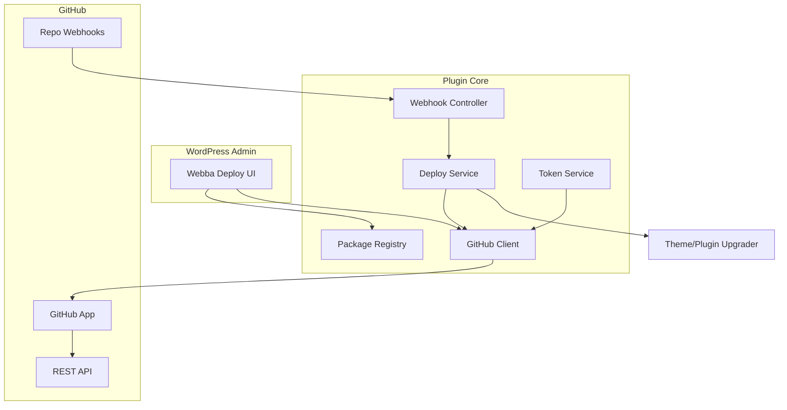

# Webba Deploy — Product & Technical Plan

**Plugin name:** Webba Deploy  
**Slug (suggested):** `webba-deploy`  
**License:** GPL-2.0-or-later  
**Distribution:** WordPress.org (free) + public GitHub repo  
**Scope (v1):** GitHub only — public repos + private repos via **GitHub App** (no deploy keys in v1)

---

## 1. Vision & goals

Webba Deploy lets site admins **install and update** WordPress **plugins** and **themes** directly from GitHub repositories, including **private** repos, using a **GitHub App** connection (connect once → pick repo → deploy).

### Core outcomes

| Goal | Description |
|------|-------------|
| Install from GitHub | Add plugin or theme from a public or private repo |
| Update from GitHub | Manual “Deploy now” + optional automatic deploy on push |
| GitHub App auth | No per-user PAT required for private repos (when App is used) |
| Push-to-deploy | Unique webhook URL per package + optional App-managed webhooks |
| WordPress-native | Uses `Plugin_Upgrader` / `Theme_Upgrader`; no Git binary required |
| Org-ready | Multisite-aware later; v1 single-site focus acceptable |

### Non-goals (v1)

- Bitbucket, GitLab, Gitea  
- Deploy keys / SSH `git clone`  
- Freemius / paid tier  
- Composer-based dependency management inside deployed packages  

---

## 2. User flows (UX)

### 2.1 Settings → GitHub connection (site-level)

**Location:** `Settings → Webba Deploy → GitHub`

1. Admin sees connection status: **Not connected** / **Connected as {account}**.
2. **Connect GitHub App** button:
   - Links to GitHub App installation (or plugin-hosted setup wizard).
   - After install, store **installation ID**, **account login**, **account type** (user/org).
3. **Disconnect** removes installation data (with confirm); packages using that connection show warning.

Optional (v1.1): support **custom GitHub App** (user registers their own App ID + PEM) vs **bundled Webba Deploy App** (single App on wordpress.org — see §6).

---

### 2.2 Add package wizard

**Entry:** `Webba Deploy` menu → **Add Plugin** or **Add Theme** (two clear CTAs on dashboard).

| Step | Public repository | Private repository |
|------|-------------------|---------------------|
| 1 | Choose visibility: **Public** / **Private** | Same |
| 2 | Enter repo URL `https://github.com/owner/repo` OR search (public: validate URL) | Require **GitHub App connected**; if not → prompt to connect |
| 3 | Branch (default `main`), optional subdir note in help text | **Load repositories** from installation → dropdown; filter/search |
| 4 | Confirm **folder slug** (auto-detect from repo name; editable) | Same |
| 5 | Deploy method: manual only / **Enable push deploy** | Same + offer **auto-configure webhook** if App has `administration: write` on repo |
| 6 | **Install now** | Same |

After success: redirect to package row on dashboard with status, last deploy time, webhook URL.

---

### 2.3 Dashboard (per package)

Each linked package shows:

- Type: Plugin / Theme  
- Repo: `owner/repo` @ `branch`  
- Visibility: Public / Private  
- **Deploy now** button  
- **Push-to-deploy URL** (copy) + secret token  
- Webhook status: Not configured / Configured / Auto (GitHub App)  
- Last deploy: time, result, link to log  

---

### 2.4 Deploy triggers

| Trigger | Behavior |
|---------|----------|
| Manual | Admin clicks **Deploy now** |
| Push-to-deploy URL | `POST` or `GET` to REST route with `secret` + `package` + `type` (GitHub Actions, generic CI) |
| GitHub webhook (App) | On `push` to configured branch → plugin receives event → deploy |

**Auto webhook (v1 target):** When user enables push deploy on a private repo and App has permission, plugin calls GitHub API to create/update repo webhook pointing to your REST endpoint, with shared secret.

---

## 3. Technical architecture

### 3.1 High-level diagram



### 3.2 Deploy pipeline (single code path)

1. Resolve package config (repo, branch, auth).  
2. Obtain credentials:
   - **Public:** no token (anonymous zipball; rate limits apply).  
   - **Private:** installation access token (GitHub App).  
3. `GET /repos/{owner}/{repo}/zipball/{ref}` with `Authorization: Bearer {token}`, follow redirect, save to temp file.  
4. Run `Plugin_Upgrader` or `Theme_Upgrader` with local zip path (`clear_destination` = true for updates).  
5. Log result; fire `webba_deploy_after_deploy` action.  
6. Optional: flush supported caches (filterable hook).

### 3.3 No Git on server

All deploys use **HTTP zipball** only — works on shared hosting. Deploy keys deferred to v2+.

---

## 4. GitHub App design

### 4.1 App registration (your repo / docs)

Create **Webba Deploy** GitHub App (one App for all users, typical for WP.org plugins — each site gets an **installation**).

**Suggested permissions (repository):**

| Permission | Access | Why |
|------------|--------|-----|
| Contents | Read | Download zipball / metadata |
| Metadata | Read | Repo list, default branch |
| Webhooks | Read & write | Auto-configure push webhooks |

**Subscribe to events:** `push` (and optionally `ping` for webhook test).

**Callback URLs (examples):**

- Install: `https://site.com/wp-admin/admin.php?page=webba-deploy-github&action=callback`  
- Webhook: `https://site.com/wp-json/webba-deploy/v1/github`  

For local dev: document use of ngrok or GitHub App manifest / smee.io in `docs/development.md`.

### 4.2 Credentials storage (encrypted)

Store in `wp_options` (prefix `webba_deploy_`):

```php
[
  'installation_id'   => 12345678,
  'account_login'     => 'my-org',
  'account_type'      => 'organization',
  'repository_ids'    => [], // cache optional
  'webhook_secret'    => 'encrypted', // for verifying incoming deliveries
  'connected_at'      => '2026-05-24T...',
]
```

**App private key:** PEM file path in `wp-config.php` constant **or** encrypted blob in options (prefer constant on hardened sites):

```php
define( 'WEBBA_DEPLOY_GITHUB_APP_ID', 123456 );
define( 'WEBBA_DEPLOY_GITHUB_APP_KEY', '/path/to/private-key.pem' );
// Or base64 in env — document in readme
```

Never commit PEM to GitHub; ship **example** `.env.example` / `webba-deploy-config-sample.php`.

### 4.3 Token service

- Build JWT (RS256) from App ID + PEM (`iss`, `iat`, `exp` ~9 min).  
- `POST /app/installations/{installation_id}/access_tokens` → cache token in transient until `expires_at - 60s`.  
- Use token for zipball + repo list + webhook CRUD.

**PHP dependency (v1):** minimal JWT lib via Composer **bundled in plugin** (wordpress.org allows vendor if needed) **or** small internal JWT implementation — document in plan for reviewer.

### 4.4 Install / connect flow

1. User clicks **Connect GitHub App**.  
2. Redirect to `https://github.com/apps/{app-slug}/installations/new` (with `state` nonce).  
3. User selects org/repos → GitHub redirects back with `installation_id` (or use setup URL + polling).  
4. Plugin exchanges/records installation; tests API with `GET /installation/repositories`.  
5. Show success + account name.

**Security:** verify `state` nonce; `manage_options` capability; HTTPS only.

### 4.5 Repo picker (private)

- `GET /installation/repositories` (paginate).  
- Admin UI: searchable select `owner/repo`.  
- On select: fetch default branch (`GET /repos/{owner}/{repo}`) → prefill branch field.

### 4.6 Public repositories without App

- Parse URL → `owner`, `repo`.  
- Zipball: `https://api.github.com/repos/{owner}/{repo}/zipball/{ref}` (no auth if public).  
- Optional: still allow App connection for higher rate limits.

---

## 5. Push-to-deploy & webhooks

### 5.1 Per-package deploy URL

```
https://example.com/wp-json/webba-deploy/v1/deploy
  ?secret={site_secret}
  &package={slug}
  &type=plugin|theme
```

- **Site secret:** generated on activation; rotatable in settings.  
- **Permission callback:** validate `secret` (timing-safe compare); no public unauthenticated deploy without secret.  
- Support `POST` body for CI (GitHub Actions `curl` example in docs).

### 5.2 GitHub App webhook endpoint

```
POST /wp-json/webba-deploy/v1/github
```

- Verify `X-Hub-Signature-256` using App webhook secret (or per-installation secret from App settings).  
- Handle `push`: if `ref` matches `refs/heads/{configured_branch}` and repo matches a registered package → queue deploy.  
- Handle `ping` → 200 OK.  
- Idempotency: debounce same commit SHA within N seconds (transient).

### 5.3 Auto-configure repo webhook

When user enables **Auto deploy on push** for a package:

1. Check App has `webhooks: write`.  
2. `POST /repos/{owner}/{repo}/hooks` with:
   - `config.url` = plugin GitHub webhook REST URL  
   - `config.secret` = site webhook secret  
   - `events` = `['push']`  
3. Store `hook_id` on package record for later update/delete.  
4. On package delete / disable auto-deploy → `DELETE /repos/{owner}/{repo}/hooks/{hook_id}`.

If App lacks webhook permission: fall back to manual instructions (show payload URL + secret + GitHub UI steps).

### 5.4 GitHub Actions template (docs)

Ship `docs/examples/deploy-on-push.yml` for users without App webhooks:

```yaml
on:
  push:
    branches: [main]
jobs:
  deploy:
    runs-on: ubuntu-latest
    steps:
      - run: curl -X POST "${{ secrets.WEBBA_DEPLOY_URL }}"
```

---

## 6. Data model

### 6.1 Options / tables

**v1:** `wp_options` only (simple, WP.org friendly).

| Option key | Content |
|------------|---------|
| `webba_deploy_github` | App connection (encrypted fields) |
| `webba_deploy_site_secret` | Push-to-deploy secret |
| `webba_deploy_plugins` | Array of package configs |
| `webba_deploy_themes` | Array of package configs |
| `webba_deploy_settings` | Global toggles (logging, cache flush) |

### 6.2 Package record schema

```php
[
  'id'              => 'uuid-v4',
  'slug'            => 'my-plugin',           // WP folder name
  'type'            => 'plugin|theme',
  'visibility'      => 'public|private',
  'owner'           => 'acme',
  'repo'            => 'my-plugin',
  'branch'          => 'main',
  'auth'            => 'none|github_app',
  'auto_deploy'     => true|false,
  'webhook_id'      => 12345|null,            // GitHub hook id if auto
  'last_deploy'     => [
    'time'    => 'mysql datetime',
    'commit'  => 'sha|null',
    'status'  => 'success|error',
    'message' => '...',
  ],
  'created_at'      => '...',
]
```

### 6.3 Encryption helper

- `webba_deploy_encrypt( $plain )` / `decrypt()` using `openssl_encrypt` + `wp_salt( 'auth' )`.  
- Encrypt: installation-related secrets if stored in DB; never log decrypted values.

---

## 7. Plugin file structure

```
webba-deploy/
├── webba-deploy.php                 # Bootstrap, constants, GPL header
├── readme.txt                       # WordPress.org
├── LICENSE                          # GPL-2.0-or-later full text
├── uninstall.php
├── includes/
│   ├── Plugin.php                   # Hooks registration
│   ├── Admin/
│   │   ├── Menu.php
│   │   ├── DashboardPage.php
│   │   ├── AddPackagePage.php
│   │   ├── GitHubSettingsPage.php
│   │   └── Assets.php
│   ├── Core/
│   │   ├── PackageRepository.php
│   │   ├── DeployService.php
│   │   ├── ArchiveDownloader.php
│   │   └── UpgraderFactory.php
│   ├── GitHub/
│   │   ├── AppConfig.php
│   │   ├── JwtGenerator.php
│   │   ├── InstallationTokenService.php
│   │   ├── ApiClient.php
│   │   ├── ConnectController.php
│   │   └── WebhookManager.php
│   ├── Rest/
│   │   ├── DeployController.php
│   │   └── GitHubWebhookController.php
│   ├── Security/
│   │   ├── Capability.php
│   │   └── Crypto.php
│   └── Logging/
│       └── Logger.php
├── assets/
│   ├── css/admin.css
│   └── js/admin.js
├── languages/
│   └── webba-deploy.pot
└── docs/                            # GitHub only (or mirror in wiki)
    ├── github-app-setup.md
    ├── development.md
    └── examples/
        └── deploy-on-push.yml
```

**Text domain:** `webba-deploy`  
**Namespace:** `WebbaDeploy\` (PSR-4 autoload without Composer in v1, or lightweight Composer autoload committed)

---

## 8. WordPress.org & compliance

### 8.1 Requirements checklist

- [ ] GPL-2.0-or-later in plugin header + `LICENSE`  
- [ ] No phone-home tracking without consent  
- [ ] Capabilities: `manage_options` for settings; `install_plugins` / `install_themes` for deploy actions  
- [ ] Nonces on all forms; sanitize/escape output  
- [ ] `readme.txt` with stable tag, tested up to, changelog  
- [ ] No bundled secrets; App key via filter/constant  
- [ ] `uninstall.php` — option to delete all data  
- [ ] Prefix all hooks/options: `webba_deploy_`  
- [ ] PHPCS with WordPress Coding Standards  

### 8.2 GitHub public repo

- GPL for **plugin code**; document that **your** GitHub App credentials are not in repo  
- Issue templates, CONTRIBUTING.md  
- GitHub Actions: PHPCS, PHPUnit, plugin zip artifact on tag  

---

## 9. Security summary

| Area | Measure |
|------|---------|
| Deploy URL | Long random secret; `hash_equals`; rate limit via transient |
| GitHub webhook | HMAC `X-Hub-Signature-256` verification |
| OAuth state | Nonce, single use |
| Tokens | Short-lived; transients; never expose in HTML/JS |
| Capabilities | Strict checks on admin + REST |
| Filesystem | `WP_Filesystem`; validate zip before upgrader |
| SSRF | Only allow `api.github.com` / `github.com` hosts for downloads |

---

## 10. Development phases

### Phase 0 — Scaffold (1–2 days)

- [ ] Plugin skeleton, autoload, admin menu, empty pages  
- [ ] `readme.txt`, LICENSE, uninstall  
- [ ] PHPCS + basic CI  

### Phase 1 — Public deploy (3–5 days)

- [ ] Package repository (plugins/themes options)  
- [ ] Add Plugin / Add Theme wizard (public only)  
- [ ] Archive downloader + upgrader integration  
- [ ] Dashboard: Deploy now, delete package  
- [ ] Logger (ring buffer in option or custom table — start with option, max 50 entries)  

### Phase 2 — Push-to-deploy URL (2–3 days)

- [ ] Site secret generation + rotation UI  
- [ ] REST `deploy` endpoint  
- [ ] Docs + GitHub Actions example  

### Phase 3 — GitHub App foundation (5–7 days)

- [ ] Register App (staging + production)  
- [ ] JWT + installation token service  
- [ ] Connect / disconnect UI  
- [ ] Private repo picker + install flow  

### Phase 4 — Private deploy (3–4 days)

- [ ] Authenticated zipball download  
- [ ] Add private package wizard end-to-end  
- [ ] Error messages (403, repo not in installation, etc.)  

### Phase 5 — Webhooks (4–5 days)

- [ ] Incoming App webhook endpoint + signature verify  
- [ ] Push → deploy matching packages  
- [ ] Auto-create repo webhook API + cleanup on delete  
- [ ] Manual fallback instructions in UI  

### Phase 6 — Polish & release (5+ days)

- [ ] i18n, accessibility, admin UX pass  
- [ ] Cache flush hook (filterable list of popular plugins)  
- [ ] Plugin review prep (wordpress.org)  
- [ ] E2E manual test matrix (see §11)  
- [ ] v1.0.0 tag on GitHub + SVN deploy  

**Estimated v1:** ~4–6 weeks part-time; ~2–3 weeks full-time.

---

## 11. Test matrix (manual v1)

| # | Case | Expected |
|---|------|----------|
| 1 | Public plugin install, branch `main` | Installed under `wp-content/plugins/{slug}` |
| 2 | Public theme install | Installed under `themes/{slug}` |
| 3 | Update existing plugin (deploy again) | Overwrites files, activates if was active |
| 4 | Private repo without App | Blocked with connect prompt |
| 5 | Connect App → pick private repo | Install succeeds |
| 6 | Push to wrong branch | No deploy |
| 7 | Push to correct branch (webhook) | Auto deploy + log |
| 8 | Push-to-deploy URL with bad secret | 401 |
| 9 | Push-to-deploy URL with good secret | Deploy success |
| 10 | Delete package with auto webhook | GitHub hook removed |
| 11 | Uninstall plugin | Options removed (if user opted in) |

---

## 12. Branding & naming

| Item | Value |
|------|--------|
| Plugin Name | Webba Deploy |
| Slug | `webba-deploy` |
| Text domain | `webba-deploy` |
| GitHub repo | `github.com/{your-org}/webba-deploy` |
| GitHub App name | Webba Deploy (slug e.g. `webba-deploy`) |
| Menu icon | `dashicons-download` or custom SVG |

Tagline (readme): *Deploy plugins and themes from GitHub — public or private — with one-click installs and push-to-deploy.*

---

## 13. Copy-paste bootstrap checklist (new directory)

When you open a new Cursor window in an empty folder:

```bash
mkdir webba-deploy && cd webba-deploy
git init
# Create files from §7 structure
# Copy this plan to PLAN.md
```

**First implementation prompt for the new window:**

> Implement Phase 0 and Phase 1 of PLAN.md for Webba Deploy: GPL-2.0+ WordPress plugin `webba-deploy`, public GitHub repo install for plugins and themes, Add Plugin / Add Theme admin flow, zipball deploy via core upgrader, package dashboard with Deploy now. No GitHub App yet.

**Second prompt:**

> Implement Phase 2: push-to-deploy REST endpoint with rotatable site secret.

**Third prompt:**

> Implement Phases 3–5: GitHub App connect, private repo picker, authenticated deploy, webhooks (receive + auto-configure).

---

## 14. Future (post-v1 roadmap)

- Deploy keys + Git path for VPS hosts  
- GitLab / Bitbucket  
- Multisite network admin  
- WP-CLI: `wp webba-deploy deploy {slug}`  
- Rollback / backup before deploy  
- Branch preview / staging slot  

---

## 15. Key decisions to confirm before coding

1. **Single shared GitHub App** (recommended for WP.org) vs each user brings their own App — v1: **shared App** with docs for self-hosted App via constants.  
2. **Composer in plugin** — yes/no for JWT only (wordpress.org reviewers accept small vendor).  
3. **Default branch detection** — auto from API vs user always picks.  
4. **Subdirectory repos** (monorepo) — v1: document “repo root must be plugin/theme root”; v2: subdirectory field.
