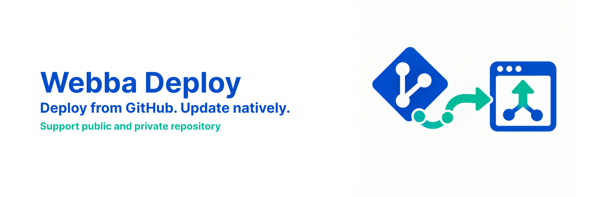

<p align="center">
  
</p>

# Webba Deploy

Deploy WordPress plugins and themes from GitHub — public or private repositories — without Git on the server.

## Features

- **Install and update from GitHub** — add a repository URL, pick a branch, deploy.
- **Private repositories** — read-only GitHub App, connected in one click.
- **Native update screens** — managed packages appear on the Plugins and Themes screens.
- **Push-to-deploy** — REST endpoint secured by a rotatable site secret for CI and GitHub Actions.
- **Dashboard** — commit comparison, deploy status, and per-package actions.

## Requirements

- WordPress 6.0 or later
- PHP 7.4 or later with the OpenSSL extension
- A public HTTPS URL for one-click GitHub App setup

## Install

1. Download the latest release: [webba-deploy.zip](https://github.com/giodc/webba-deploy/releases/latest/download/webba-deploy.zip)
2. In WordPress go to **Plugins → Add New → Upload Plugin**, choose the zip, install, and activate.
3. Open **Webba Deploy** in the admin menu.

Or with WP-CLI:

```bash
wp plugin install https://github.com/giodc/webba-deploy/releases/latest/download/webba-deploy.zip --activate
```

## Updates

Webba Deploy updates itself from this repository's GitHub Releases using the WordPress `Update URI` mechanism. Automatic updates are enabled on activation and can be turned off on the **Plugins** screen.

## Documentation

- [GitHub App setup](docs/github-app-setup.md)
- [Push-to-deploy](docs/push-to-deploy.md)
- [Development](docs/development.md)

## License

GPL-2.0-or-later. See [LICENSE](LICENSE).
